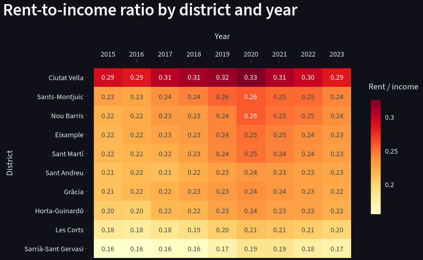
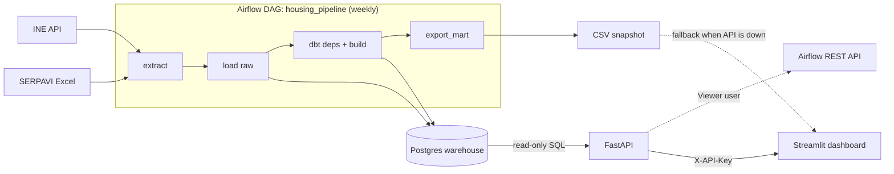
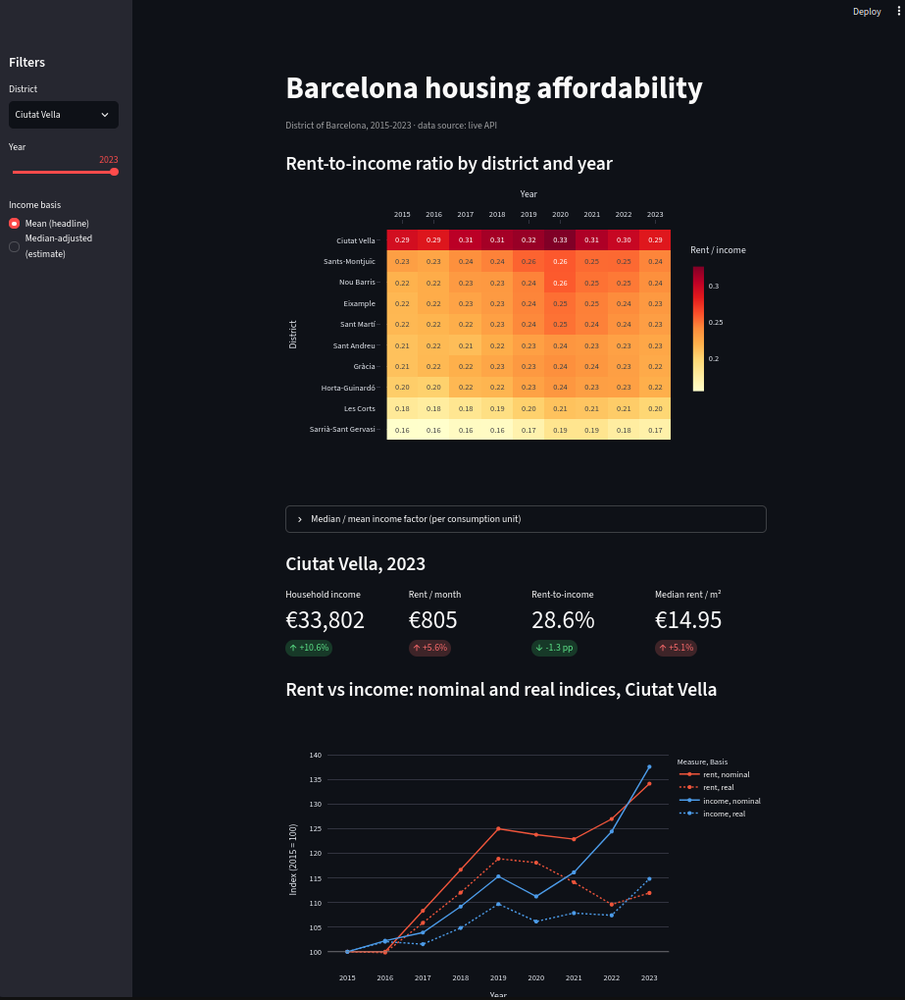
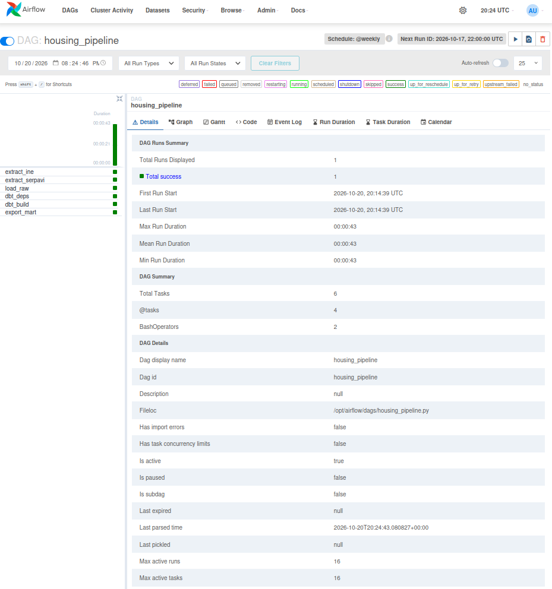
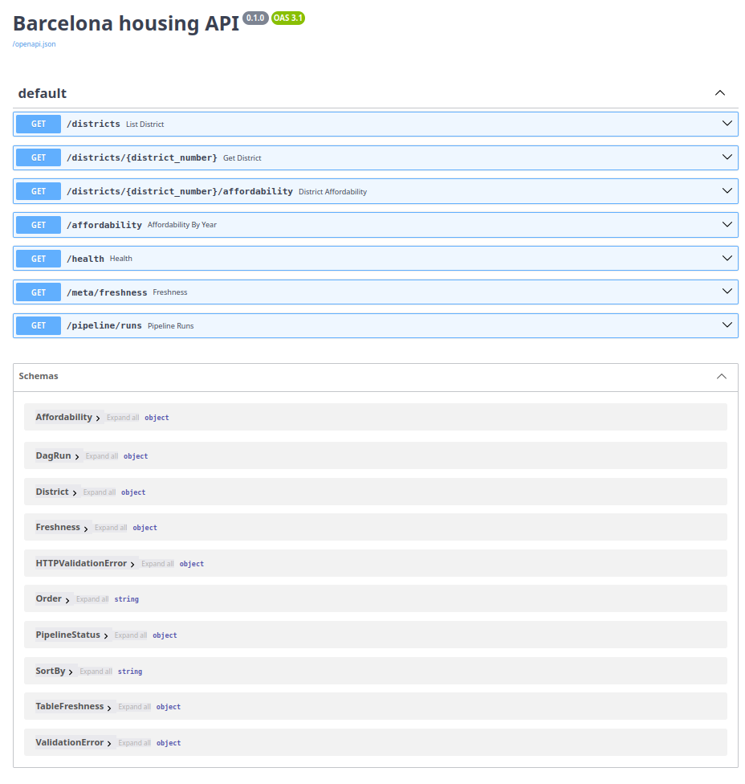

# Barcelona Housing Affordability (2015-2023)

An end-to-end data pipeline that answers one question: **how affordable is renting in each of Barcelona's 10 districts, and how has that changed?**

Public data (INE, Ministry of Housing) is extracted, loaded into Postgres, modelled with dbt, orchestrated with Airflow, served through a FastAPI API, and explored in a Streamlit dashboard.

**Live dashboard: https://barcelona-housing-2015-2023.streamlit.app/** (the hosted demo has no warehouse behind it, so it runs on the committed CSV snapshot; the full stack runs locally, see [Run it locally](#run-it-locally))



## Key findings

"Rent burden" below means monthly rent × 12 divided by the district's average household net income. It compares rent with local incomes; it does not say where renting is cheap in absolute terms.

- **Ciutat Vella has the highest rent burden in every year**: about 29% of average household net income in 2023, peaking at 33% in 2020.
- **Sarrià-Sant Gervasi has the lowest, about 17% in 2023, but that does not make it cheap to rent.** It has the highest average monthly rent of the ten districts (1,173 € vs 805 € in Ciutat Vella) and the second-highest median rent per m² (14.70 €). Its average household income is higher still (81,478 € vs 33,802 €, about 2.4 times Ciutat Vella's), and top earners pull that average up more there than anywhere else (median-to-mean income ratio 0.74, the lowest of the ten), so the ratio comes out low.
- **The income in the denominator covers all households, owners and renters alike.** Renters tend to earn less than their district's average, so the ratio probably understates the burden on actual renters, by different amounts in different districts. Read the ranking as relative pressure between districts, not as what renters pay out of their own income.
- **On average, rent burden rose until 2020 and eased slightly afterwards**, but nine of the ten districts are still above their 2015 level. The exception is Ciutat Vella, which is back slightly below its own 2015 level (28.6% vs 29.3%) while remaining the most burdened.
- In Ciutat Vella, rent grew faster than income until 2022. In 2023 income overtook it (nominal indices, 2015 = 100), which is why the ratio fell 1.3 percentage points that year.
- **The median-adjusted view limits the pull of top earners.** Average income is lifted by the highest earners, which lowers the ratio most where incomes are most skewed. To see the burden with less of that effect, the dashboard also offers a median-adjusted estimate: average income scaled by each district's median-to-mean ratio. It raises every ratio (Ciutat Vella 2023: 34.3% vs 28.6%) and closes the gap at the bottom: Sarrià-Sant Gervasi rises from 17.3% to about 23.5%, close to the middle group (the eight districts between the two extremes sit at roughly 25-28%), while Ciutat Vella stays well above all of them. It is an estimate, not a direct measure; see [Median sensitivity](#median-sensitivity-estimate) for how it is built and its limits.
- **The extremes do not change.** Ciutat Vella and Sarrià-Sant Gervasi stay the highest and lowest in 2015, 2020 and 2023 under both views. Some mid-table positions do move (for example Nou Barris and Sant Andreu rank as less burdened).

## Architecture



| Layer | Tooling | What it does |
|---|---|---|
| Extract | Python (`extract/`) | Pulls INE tables via API (income, rent index, CPI) and reads the SERPAVI rent Excel |
| Load | Python (`load/`) | Loads raw data into the `raw` schema of the Postgres warehouse |
| Transform | dbt (`dbt/`) | Staging views, then marts: `dim_district`, `fct_cpi_annual`, three fact tables and `mart_district_affordability` (90 rows: 10 districts x 2015-2023) |
| Orchestrate | Airflow 2.10 (Docker) | Weekly DAG: extract, load, `dbt deps`, `dbt build`, `export_mart`. Reruns are idempotent (the mart stays at 90 rows). `export_mart` owns the CSV snapshot |
| Serve (API) | FastAPI (`api/`) | Read-only endpoints over the mart, plus freshness and pipeline-run endpoints. API-key auth, rate limiting, TTL cache |
| Serve (UI) | Streamlit (`app/`) | Heatmap, district snapshot, real vs nominal index chart, income-basis toggle (mean / median-adjusted), raw data, pipeline status. Reads the API and falls back to the CSV snapshot |

All services run in Docker Compose: `warehouse` (Postgres 16), `airflow-db`, `airflow-init`, `airflow-webserver`, `airflow-scheduler`, `api` and `dashboard`.

## Screenshots

**Dashboard, reading from the live API**



**Airflow DAG after a successful run**



**Interactive API docs**



## API

Interactive docs at http://localhost:8001/docs (open, like `/openapi.json`). Every route except `/health` needs an `X-API-Key` header.

```bash
curl -H "X-API-Key: $API_KEY" "http://localhost:8001/affordability?year=2023&sort_by=rent_to_income_ratio&order=desc"
```

| Endpoint | Description | Notes |
|---|---|---|
| `GET /health` | Health check | No API key, exempt from rate limits |
| `GET /districts` | List the 10 districts | |
| `GET /districts/{n}` | One district | 404 if unknown |
| `GET /districts/{n}/affordability?year_from&year_to` | Affordability time series for a district | Years validated to 2015-2023 (422 otherwise) |
| `GET /affordability?year&sort_by&order` | All districts for one year, sortable | |
| `GET /meta/freshness` | Per-table data freshness, Airflow reachability and last successful DAG run | Cached, see below |
| `GET /pipeline/runs?limit` | Recent runs of the `housing_pipeline` DAG | Uncached, 10 requests/min |

Status codes: `401` wrong key, `503` API key not configured on the server (fails closed), `422` invalid parameters, `429` rate limited, `502` Airflow unreachable or returned a malformed response (`/meta/freshness` degrades to `airflow_reachable: false` instead).

### Operational notes

- **Auth:** one static key from `.env` (`API_KEY`). Fine for a single-tenant demo; there are no per-user keys.
- **Rate limits** (slowapi): 60/min per endpoint per client IP, 10/min on `/pipeline/runs`. In-memory, so they are per process and assume one worker. `X-Forwarded-For` is not trusted, so behind a proxy every client shares the proxy's IP.
- **Cache:** per-process TTL cache on `/meta/freshness` (table stats 300 s; Airflow result 20 s on success, 5 s on failure). The table stats can lag the warehouse by up to 5 minutes. If the API is ever scaled out, move rate limiting and the cache to Redis.
- **Airflow access:** the API calls Airflow's REST API through a read-only `Viewer` user (`api_readonly`), created by `airflow-init`.
- **Dashboard fallback:** if the API is down, rejects the key or rate limits the dashboard, it falls back to the committed CSV snapshot and says so in the caption.

## Data sources

| Source | Used for |
|---|---|
| INE (Spanish Statistics Institute): household income by district (table 30896) | Average household net income; median and average income per consumption unit |
| Ministry of Housing, SERPAVI | Rent in euros per month and per m² |
| INE rent price index | Rent index, as a cross-check against SERPAVI |
| INE CPI | Deflator to express rent and income in real terms |

Scope: 10 Barcelona districts, 2015-2023.

## Metric definitions

- **Rent-to-income ratio** (headline) = (monthly rent × 12) / average household net income. For example, in Ciutat Vella 2023: 805 × 12 / 33,802 = 28.6%.
- **Indices** (`*_index_nominal`, `*_index_real`) use 2015 = 100. **Real** values are deflated with the INE CPI.
- The line chart shows **indices (growth)**, not levels. A district whose rent grows slower than its income can still be much less affordable than another. Use the heatmap to compare levels. Index charts always use mean income.

## Median sensitivity (estimate)

The headline ratio uses **average** household net income, which high earners pull up, so it likely understates the burden on a typical household. INE publishes median income only per consumption unit (its median household income series is empty), so a direct median household ratio is not possible. The dashboard offers a median-adjusted view as a sensitivity check. The mean-based ratio remains the headline and the default.

```
income_median_to_mean               = median income per consumption unit / average income per consumption unit
income_median_adj_eur_est           = income_eur * income_median_to_mean
rent_to_income_ratio_median_adj_est = rent_eur_month * 12 / income_median_adj_eur_est
```

Example, Ciutat Vella 2023: 33,802 × 0.8332 = 28,164; 805 × 12 / 28,164 = 34.3%.

Limits:
- The factor is computed per consumption unit and applied to household income. A consumption unit is not a household.
- It covers all residents, not renters. Renters likely earn less, so even the adjusted ratio is probably a lower bound.
- The factor varies by district and year, so year-over-year changes in the adjusted series partly reflect changes in the factor. Compare levels, not adjusted changes.
- Columns carry an `_est` suffix to mark them as estimates.

## Limitations

- The headline ratio compares average rent with the district's **average household income**, not with the income of renter households, who tend to earn less. Read it as a relative measure between districts and years rather than an exact burden. See the median sensitivity section above.
- District-level data only: no neighbourhood detail, and years after 2023 are not included.
- The hosted demo serves the **CSV snapshot** (`export/mart_district_affordability.csv`), because the warehouse runs locally. The snapshot is written by the DAG's `export_mart` task, so a local pipeline run rewrites that tracked file. The export is deterministic, so it only shows up in `git status` when the data changed; don't commit it by accident.

## Run it locally

Needs Docker with Compose v2. Airflow is memory-hungry: close heavy applications first, and allow about 2 minutes for the webserver to come up.

### 1. Clone and configure

```bash
git clone https://github.com/DanielMilian/barcelona-housing.git
cd barcelona-housing
mkdir -p logs data/raw/serpavi        # created by you, so Docker doesn't create them as root
cp .env.example .env
sed -i "s/^AIRFLOW_UID=.*/AIRFLOW_UID=$(id -u)/" .env
for k in WAREHOUSE_PASSWORD AIRFLOW_ADMIN_PASSWORD AIRFLOW_DB_PASSWORD AIRFLOW_API_PASSWORD API_KEY; do
  sed -i "s/^$k=.*/$k=$(openssl rand -hex 16)/" .env
done
```

The variables in `.env`:

| Variable | Purpose |
|---|---|
| `WAREHOUSE_USER`, `WAREHOUSE_PASSWORD`, `WAREHOUSE_DB` | Warehouse Postgres credentials |
| `WAREHOUSE_PORT` | Host port for the warehouse (containers use 5432) |
| `AIRFLOW_UID` | Your user id (`id -u`), so bind-mounted files stay writable |
| `AIRFLOW_ADMIN_PASSWORD` | Password for the Airflow `admin` user |
| `AIRFLOW_DB_USER`, `AIRFLOW_DB_PASSWORD`, `AIRFLOW_DB_NAME` | Airflow metadata database |
| `AIRFLOW_API_USER`, `AIRFLOW_API_PASSWORD` | Read-only Airflow user the API calls (created by `airflow-init`) |
| `API_KEY` | Key clients send in `X-API-Key`; the API returns 503 if unset |
| `AIRFLOW_PORT` | Optional host port for the Airflow UI (default 8080) |

### 2. Download the SERPAVI data (manual step)

The Ministry of Housing publishes SERPAVI rents as a large Excel file with no API, so this one file is downloaded by hand and is not committed.

1. Open https://www.mivau.gob.es/vivienda/alquila-bien-es-tu-derecho/serpavi and download "BD Sistema Estatal Índices de Alquiler de Vivienda".
2. Save it as `data/raw/serpavi/serpavi_2011-2024.xlsx` in the project root. The extract step reads this exact path and fails with a clear error if it is missing.

The INE data needs no manual step; it is pulled from the INE API on every run.

### 3. Start the stack

```bash
docker compose up -d --build
docker compose ps
```

| Service | URL |
|---|---|
| Airflow | http://localhost:8080 (user `admin`, password from `AIRFLOW_ADMIN_PASSWORD`) |
| API docs | http://localhost:8001/docs |
| Dashboard | http://localhost:8501 |

### 4. Run the pipeline once

The warehouse starts empty. Until the DAG has run, the API has no data and the dashboard shows the CSV snapshot.

```bash
docker compose exec airflow-webserver airflow dags unpause housing_pipeline
docker compose exec airflow-webserver airflow dags list-runs -d housing_pipeline
```

Unpausing normally starts a run for the latest weekly interval. Only if `list-runs` shows no run, trigger one:

```bash
docker compose exec airflow-webserver airflow dags trigger housing_pipeline
```

Wait until the run is `success` (`export_mart` is the last task), then:

```bash
set -a; source .env; set +a
curl http://localhost:8001/health
curl -H "X-API-Key: $API_KEY" "http://localhost:8001/affordability?year=2023"
```

Open http://localhost:8501; the caption should read "live API".

### Tests

The tests run against the real warehouse (read-only) with Airflow mocked, so the stack must be up and the pipeline must have run once.

```bash
python3 -m venv .venv && source .venv/bin/activate
pip install -r api/requirements.txt -r api/requirements-dev.txt
cd api && set -a; source ../.env; set +a; python -m pytest -q
```

To run dbt outside Docker: `cd dbt && dbt deps` (uses `dbt_utils`).

### Stop

```bash
docker compose down        # keeps the data volumes
docker compose down -v     # also deletes the warehouse and Airflow databases
```

## Repo layout

```
api/        FastAPI service (routes, auth, rate limits, cache, tests)
app/        Streamlit dashboard
dags/       Airflow DAG
dbt/        dbt project (staging, marts, tests, packages.yml)
extract/    INE and SERPAVI extraction
load/       raw loader into Postgres
export/     mart to CSV export (owned by the DAG), used as the dashboard fallback
explore/    one-off scripts used to explore the data sources
warehouse/  Postgres init script (schemas)
docs/       images
```

## Design decisions

- **Idempotent pipeline.** Rerunning the DAG does not duplicate rows.
- **Tested models.** `dbt build` runs 55 nodes (9 models, 1 seed, 45 tests), all passing, including uniqueness of the (district, year) grain on the income fact and the mart. The 2023 mart values were spot-checked against hand calculations, and the original mean-based columns were regression-checked as unchanged after adding the median columns.
- **Sensitivity, not replacement.** The median-adjusted view is additive and labelled as an estimate; the mean-based ratio stays the headline.
- **Read-only serving layer.** The API only reads the mart, and reaches Airflow through a Viewer-role user, so a leaked API key cannot trigger or modify pipeline runs.
- **Fail closed.** If `API_KEY` is unset the API answers 503 instead of running open.
- **Degrade, don't break.** A slow, down or malformed Airflow degrades `/meta/freshness` to `airflow_reachable: false` and the dashboard falls back to the CSV snapshot.
- **Local warehouse, static public demo.** A hosted warehouse would add cost and credentials to manage for a small dataset, so the public app serves an exported snapshot.
